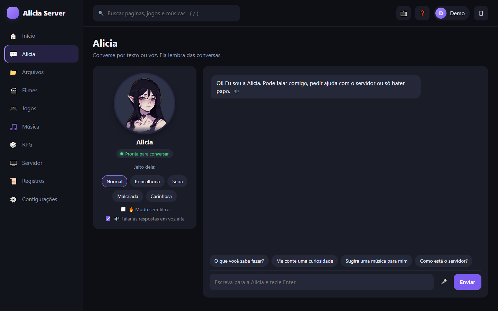
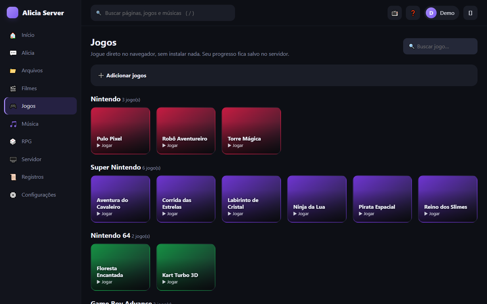
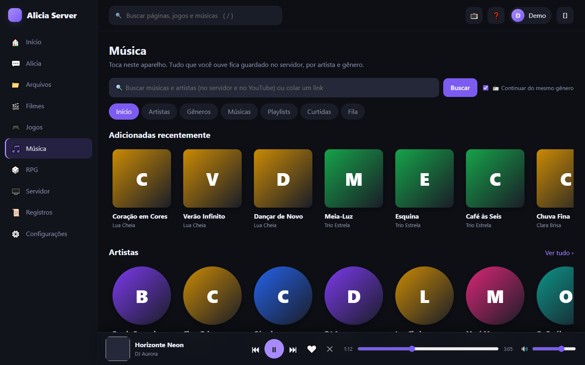
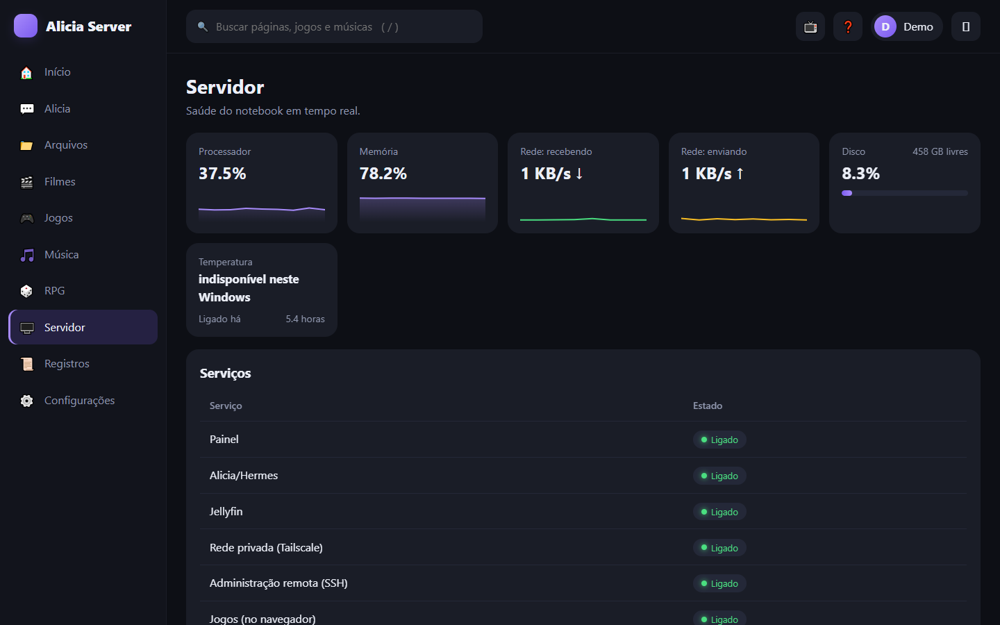
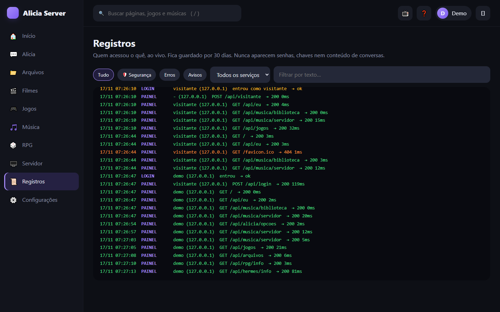
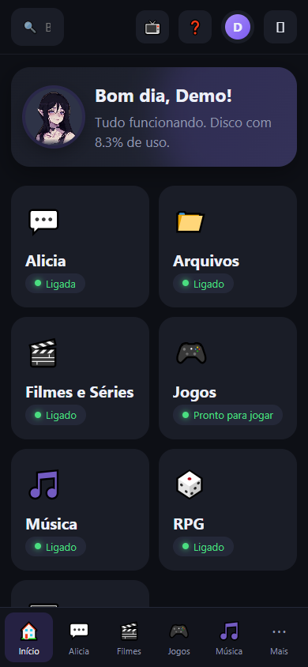
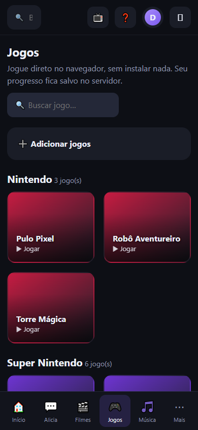
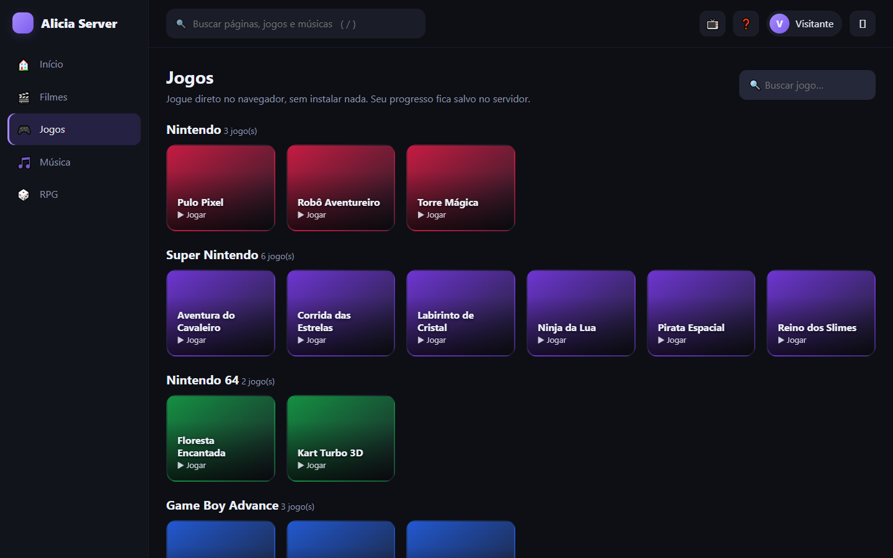
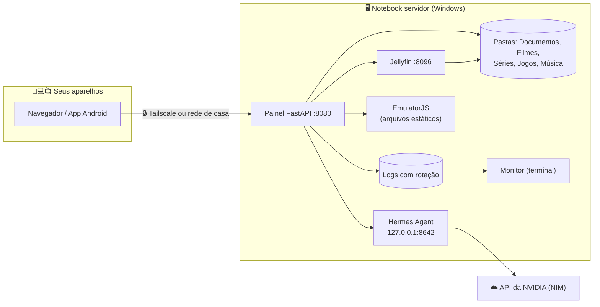

<p align="center">
  
</p>

<p align="center">
  
  
  
  
  
  
  
</p>

# Alicia Server

Um **servidor doméstico que fica ligado 24 horas** num notebook modesto (Core i5 de 3ª geração, 8 GB de RAM, HD mecânico) e reúne **num painel só**:

- 💬 **Alicia**, uma assistente de IA com personalidade, voz feminina e memória (o cérebro é o [Hermes Agent](https://github.com/NousResearch/hermes-agent) usando a API da NVIDIA);
- 📁 **Arquivos** acessíveis de qualquer aparelho, com backup automático;
- 🎬 **Filmes e séries** (Jellyfin) dentro do painel;
- 🎮 **Jogos retrô** (Nintendo, Super Nintendo, Nintendo 64, Game Boy, Game Boy Advance e PlayStation) **rodando no navegador**, sem instalar nada;
- 🎵 **Música** no estilo Jellyfin/Spotify, com aba **Descobrir** (estilos, humores, recomendações da Alicia, importar playlist do YouTube), que a Alicia toca quando você pede e que fica guardada no servidor por artista e gênero;
- 🎲 **RPG de mesa** com a Alicia como mestra (até 5 jogadores);
- 🖥️ **Monitor de acessos** ao vivo, painel de saúde do servidor e **app Android** para celular e TV box.

Tudo é acessado de **qualquer lugar por uma rede privada** (Tailscale): nenhuma porta é aberta na internet.

> 🇧🇷 Todo o projeto, a interface e a documentação estão em português do Brasil.

---

## 📸 Como é

<table>
  <tr>
    <td width="50%"><br><sub><b>Início</b>: a Alicia recebe você e cada recurso é um cartão com o estado real.</sub></td>
    <td width="50%"><br><sub><b>Alicia</b>: conversa, jeitos de falar, modo sem filtro e voz.</sub></td>
  </tr>
  <tr>
    <td><br><sub><b>Música</b>: biblioteca por artista e gênero, organizada como o Jellyfin.</sub></td>
    <td><br><sub><b>Jogos</b>: biblioteca em blocos, joga direto no navegador, progresso salvo no servidor.</sub></td>
  </tr>
  <tr>
    <td><br><sub><b>Player</b> que fica por cima de tudo: a música continua enquanto você navega ou joga.</sub></td>
    <td><br><sub><b>Servidor</b>: gráficos ao vivo, serviços e o Hermes.</sub></td>
  </tr>
  <tr>
    <td><br><sub><b>RPG</b>: personagens prontos e campanhas originais, com a Alicia mestra.</sub></td>
    <td><br><sub><b>Registros</b>: quem acessou o quê, ao vivo, sem senhas nem conteúdo.</sub></td>
  </tr>
</table>

<p align="center">
  
  
  
  
</p>
<p align="center"><sub>Celular (abas embaixo) e entrada como visitante. As imagens usam <b>dados de exemplo</b> (<code>scripts/demo</code>): nenhuma música, jogo, usuário ou endereço real aparece aqui.</sub></p>

---

## 🧩 Os sistemas

| Sistema | O que faz | Como é feito |
|---|---|---|
| **Painel web** | A porta de entrada de tudo: login, páginas, busca, tour, modo TV | FastAPI + HTML/CSS/JS puro (sem framework, leve para o notebook) |
| **Alicia** | Conversa, personalidades, modo sem filtro, voz, pede música | Prompts originais da Alicia + Hermes + voz neural Francisca (edge-tts) |
| **Hermes Agent** | Cérebro: memória entre conversas, skills, tarefas agendadas | Gateway local (API 127.0.0.1) com ferramentas limitadas |
| **Arquivos** | Pasta compartilhada, envio/prévia/download, lixeira, backup diário | Painel + pasta de rede + `robocopy` agendado |
| **Filmes e Séries** | Biblioteca de vídeo para todos os aparelhos | Jellyfin embutido no painel, login automático do usuário "casa" |
| **Jogos** | 6 consoles no navegador, saves no servidor | EmulatorJS hospedado no próprio servidor |
| **Música** | Busca, biblioteca por artista/gênero, rádio do mesmo gênero | yt-dlp + biblioteca em disco + índice JSON + gênero pela Alicia |
| **RPG** | Mesas com código, dados justos, combate, mestra IA | Regras inspiradas no SRD 5.2 (CC-BY-4.0), dados pelo servidor |
| **Monitor de acessos** | Tudo que passa pelo servidor, ao vivo, num terminal e no painel | Log JSON com rotação + `monitor.py` |
| **Visitante** | Entrada sem senha só para jogos, música, filmes e RPG | Bloqueio no servidor (não só botão escondido) |
| **Rede privada** | Acesso de fora de casa sem abrir portas | Tailscale + OpenSSH + firewall restrito |
| **App Android** | Painel no celular e na TV box | WebView em Java com endereço configurável |

➡️ Detalhes de cada um: **[docs/SISTEMAS.md](docs/SISTEMAS.md)**

## 🗺️ Arquitetura em uma imagem



➡️ Mais em **[docs/ARQUITETURA.md](docs/ARQUITETURA.md)**

## 📱 O app Android (APK)

É um **aplicativo leve que abre o painel** no celular e na TV box: uma `WebView` em tela cheia, com uma tela para você digitar o endereço do servidor (sem precisar gerar outro APK), navegação pelo controle remoto, microfone para a voz da Alicia (com o pedido de permissão do Android) e ícone próprio. Ele **não guarda dados nem roda nada pesado**: tudo continua no servidor. O projeto está em [`alicia-apk/`](alicia-apk) e a função completa, a escolha técnica e como compilar estão em **[docs/APK.md](docs/APK.md)**.

## 🚀 Começando

1. Tenha um PC com Windows 10/11 ligado sempre, Python 3.12 e Git.
2. `git clone https://github.com/didix99x/Alicia-server.git` e rode `scripts\instalar.ps1`.
3. Abra o painel, entre com o usuário criado, **cole sua chave da NVIDIA** em *Configurações* e rode **Verificar tudo**.
4. Para ligar o resto (Hermes, Jellyfin, jogos, Tailscale, tarefas automáticas) siga o passo a passo completo: **[docs/INSTALACAO.md](docs/INSTALACAO.md)**.

## 🔐 Segurança em resumo

Login com senha em hash (Argon2) e bloqueio por tentativas · portas liberadas **só** para a rede de casa e a rede privada · nada aberto na internet · segredos só em `.env` (fora do Git) · o Hermes do painel **não tem terminal nem acesso a arquivos** · o visitante é limitado **no servidor** · registros nunca guardam senhas, chaves nem conteúdo de conversas · "apagar" manda para a lixeira. Veja **[docs/SEGURANCA.md](docs/SEGURANCA.md)**.

## 📚 Documentação

| Documento | Para quê |
|---|---|
| [docs/INSTALACAO.md](docs/INSTALACAO.md) | Passo a passo completo, do zero ao servidor no ar |
| [docs/SISTEMAS.md](docs/SISTEMAS.md) | Cada sistema em detalhe: o que faz, como funciona, limites |
| [docs/ARQUITETURA.md](docs/ARQUITETURA.md) | Componentes, portas, pastas, fluxos e lista da API |
| [docs/APK.md](docs/APK.md) | O app Android: função, escolha técnica e uso |
| [docs/SEGURANCA.md](docs/SEGURANCA.md) | Modelo de segurança e privacidade |
| [docs/ESTADO.md](docs/ESTADO.md) | O que foi testado de verdade e o que ainda não |
| [docs/DECISOES.md](docs/DECISOES.md) | Decisões tomadas, por quê e alternativas descartadas |
| [docs/PROBLEMAS.md](docs/PROBLEMAS.md) | Como resolver os problemas mais prováveis |
| [docs/JOGOS.md](docs/JOGOS.md) | Guia dos jogos retrô |
| [docs/INSTALADO.md](docs/INSTALADO.md) | Tudo que é instalado, versão e origem |
| [docs/CREDITOS.md](docs/CREDITOS.md) | Licenças, atribuição do SRD e créditos |
| [docs/ETAPAS.md](docs/ETAPAS.md) | Diário de construção etapa por etapa |

## 🗂️ Estrutura do repositório

```text
Alicia-server/
├─ painel/               Painel web (FastAPI)
│  └─ app/
│     ├─ main.py         API, login, status, arquivos, música, jogos, filmes, visitante...
│     ├─ alicia_ponte.py Alicia ↔ Hermes (prompt, expressões, voz)
│     ├─ rpg.py          Motor do RPG (dados, personagens, campanhas, combate)
│     └─ web/            Interface: index.html, app.css, app.js, p_a.js, p_b.js, jogar.html
├─ alicia/               A Alicia (prompts, personalidades, modo sem filtro, imagens, pôquer)
│  ├─ alicia_core/       Código reaproveitado do projeto original
│  └─ desktop_legado/    App desktop antigo (PyQt), guardado só como referência
├─ scripts/              Instalação, tarefas agendadas, monitor, backup, Hermes, demonstração
├─ alicia-apk/           Projeto do app Android (Java) + guia de compilação
└─ docs/                 Documentação e imagens
```

## ⚠️ Avisos importantes

- **Sem jogos, BIOS, filmes nem músicas no repositório.** Você coloca os seus. Nada protegido por direitos autorais é distribuído aqui.
- A **música** é obtida pelo servidor com o `yt-dlp`, o que contraria os termos de uso do YouTube e pode ferir direitos autorais. É uma escolha do dono do servidor, para uso pessoal; leia [docs/DECISOES.md](docs/DECISOES.md).
- O único serviço externo pago/com cota é a **API da NVIDIA**; o consumo é controlado e a chave nunca fica no código.

## 🙏 Créditos

[Hermes Agent](https://github.com/NousResearch/hermes-agent) (Nous Research) · [Jellyfin](https://jellyfin.org) · [EmulatorJS](https://github.com/EmulatorJS/EmulatorJS) · [Tailscale](https://tailscale.com) · [yt-dlp](https://github.com/yt-dlp/yt-dlp) · [edge-tts](https://github.com/rany2/edge-tts) · SRD 5.2 (Wizards of the Coast, CC-BY-4.0). Lista completa em [docs/CREDITOS.md](docs/CREDITOS.md).

---

<p align="center"><sub>Feito com carinho para rodar em hardware humilde. 🖤</sub></p>
