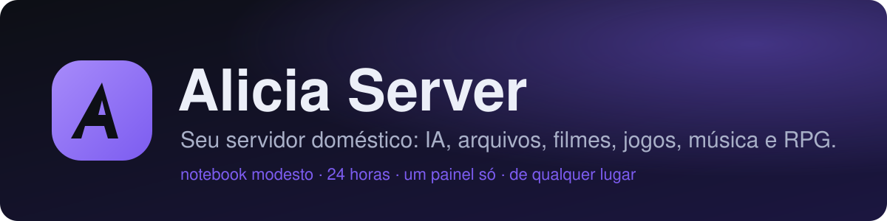
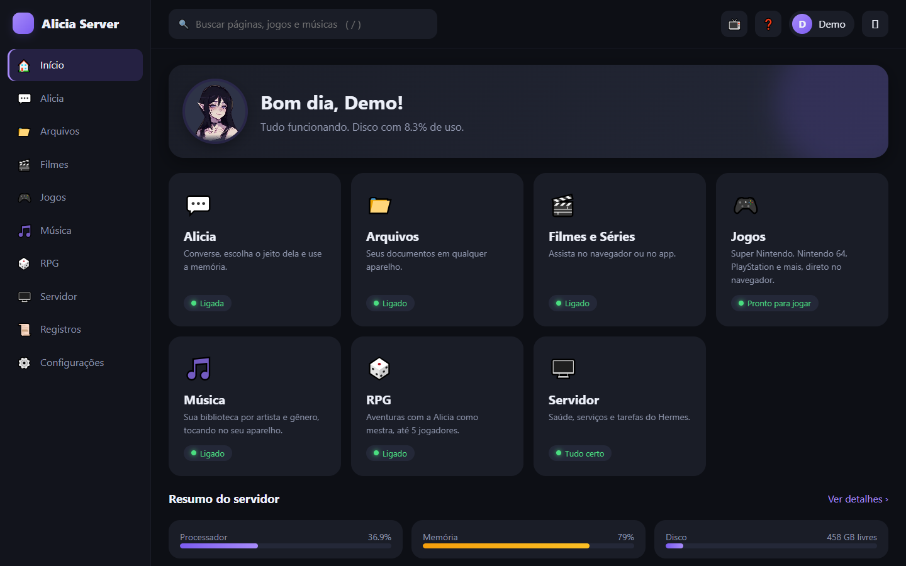
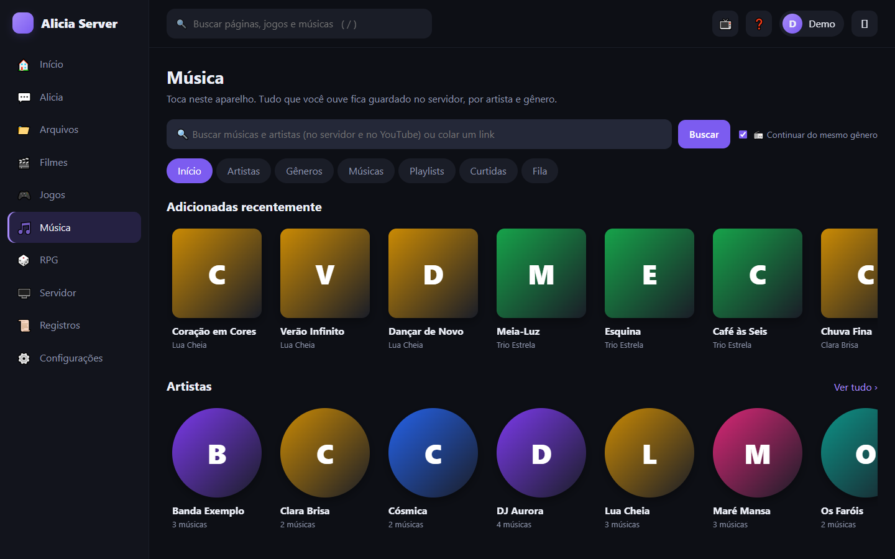
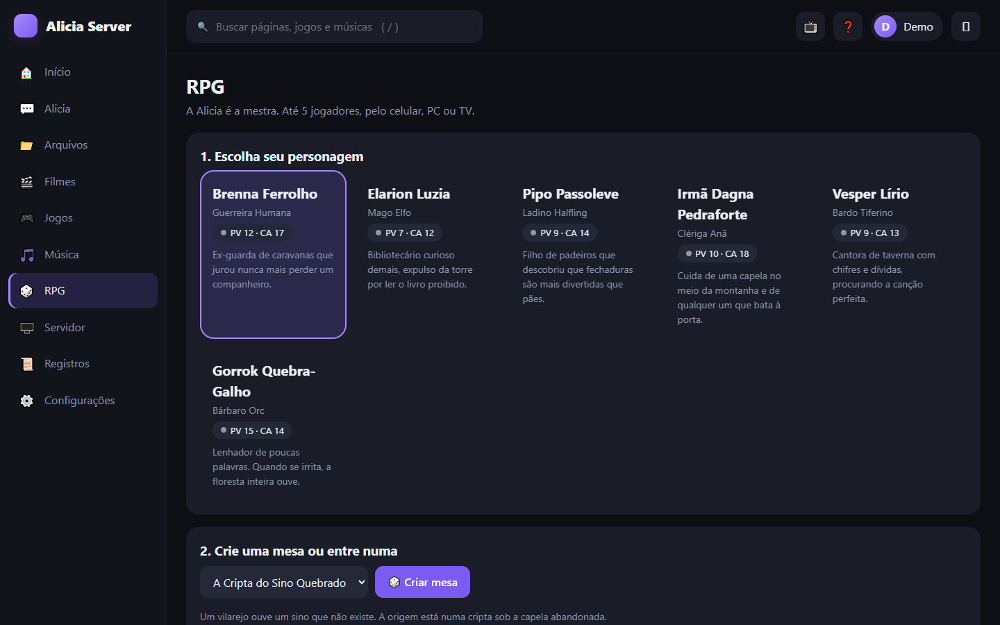
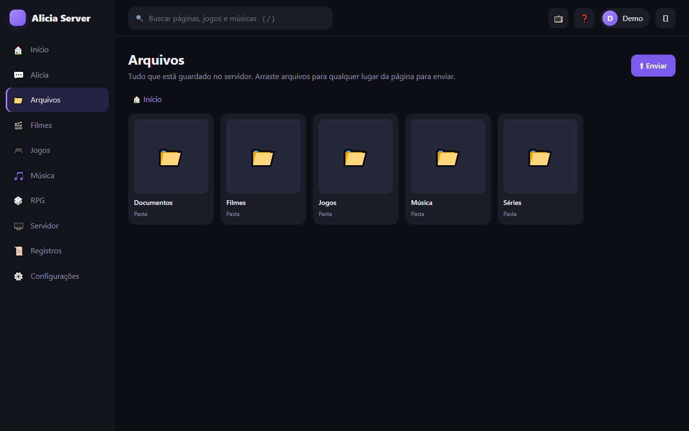
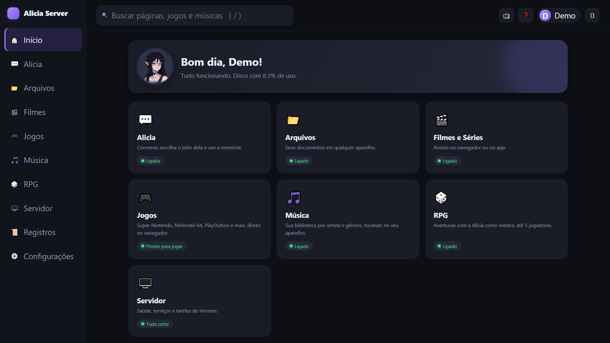
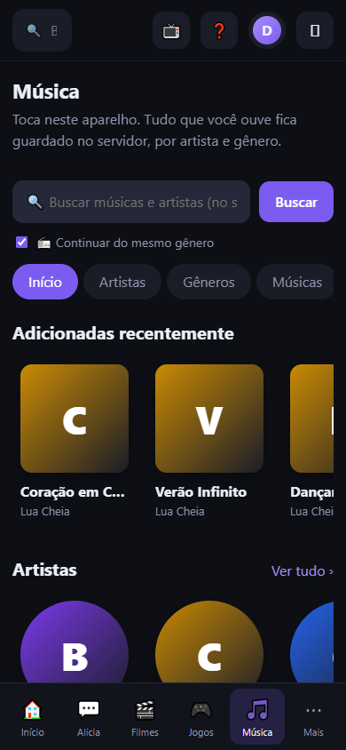
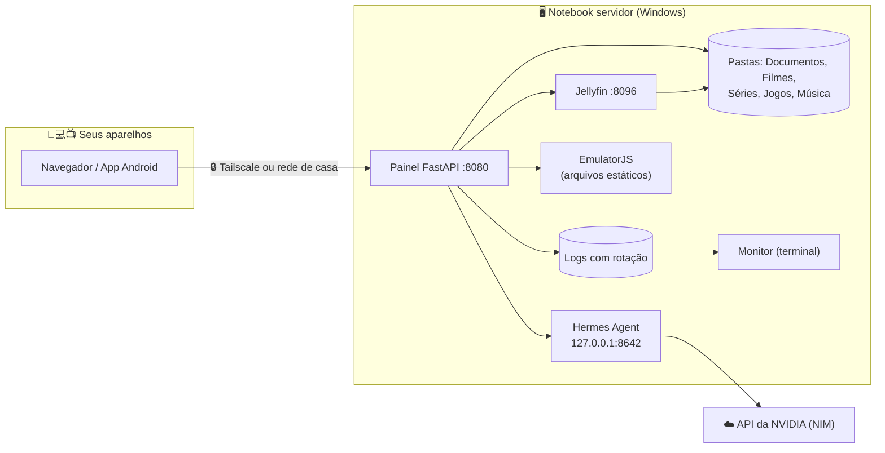

<p align="center">
  
</p>

<h3 align="center">🏠 O servidor doméstico com uma assistente de IA dentro.<br>Filmes, jogos, música, arquivos e RPG num painel só, rodando num notebook velho.</h3>

<p align="center">
  
  
  
  
  
  
  
  
  
</p>

<p align="center">
  <a href="#-o-que-%C3%A9">O que é</a> ·
  <a href="#-funcionalidades-uma-por-uma">Funcionalidades</a> ·
  <a href="#-como-%C3%A9">Capturas</a> ·
  <a href="#%EF%B8%8F-arquitetura">Arquitetura</a> ·
  <a href="#-come%C3%A7ando">Começando</a> ·
  <a href="#-documenta%C3%A7%C3%A3o">Documentação</a> ·
  <a href="#-cr%C3%A9ditos">Créditos</a>
</p>

---

## ✨ O que é

O **Alicia Server** transforma um **notebook modesto** (Core i5 de 3ª geração, 8 GB de RAM, HD mecânico) num **servidor que fica ligado 24 horas** e que a família inteira usa pelo **celular, TV box, tablet ou PC**, em casa ou na rua.

Você abre **um endereço**, escolhe o que quer e pronto:

> 💬 *"Alicia, toca uma música pra treinar."* → ela abre o player e toca no seu aparelho.
> 🎮 Escolhe um jogo de Super Nintendo e joga direto no navegador, **sem instalar nada e sem fazer login**.
> 🎬 Abre o Jellyfin em tela cheia, já logado, e assiste ao filme.
> 🎲 Chama os amigos para uma mesa de RPG com a Alicia como mestra.

| 🖥️ Roda em hardware humilde | 🔒 Nada exposto na internet | 💸 Custo | 🇧🇷 Idioma |
|---|---|---|---|
| Tarefas pesadas (emulação, vídeo) rodam **no seu aparelho**, não no servidor | Acesso de fora de casa só pela rede privada **Tailscale** | Só a API da NVIDIA (com cota gratuita) | Tudo em **português do Brasil** |

---

## 🧭 Funcionalidades, uma por uma

> Cada item abaixo tem um guia completo com o passo a passo de uso em **[docs/FUNCIONALIDADES.md](docs/FUNCIONALIDADES.md)**.

<table>
<tr>
<td width="50%" valign="top">

### 💬 Alicia, a assistente
Conversa com **personalidade própria**, vários **jeitos de falar** e um **modo sem filtro**. Tem **voz feminina** (Francisca, neural) e **lembra de conversas anteriores**. Ela **toca música quando você pede**, controla o player (pausa, próxima, volume) e **analisa o próprio servidor com números reais**: memória, disco, backup, acessos e alertas.

</td>
<td width="50%" valign="top">

### 🎵 Música estilo Spotify/Jellyfin
Busca em biblioteca e YouTube, **toca no aparelho que você está usando** (não no notebook), **rádio do mesmo gênero** quando a música acaba, fila, curtidas, playlists e um player que **fica por cima de tudo**, até com jogo aberto. O servidor **guarda cada música por artista e gênero**.

</td>
</tr>
<tr>
<td valign="top">

### 🔎 Descobrir (repertório)
**20 estilos** e **12 humores** (Treinar, Estudar, Relaxar, Dormir, Festa…), cada um com um **mix de 14 faixas escolhido pela Alicia**. Ela também **recomenda pelo seu gosto**, você **importa uma playlist do YouTube** e manda **guardar tudo no servidor** em segundo plano.

</td>
<td valign="top">

### 🎮 Jogos retrô no navegador
**Nintendo, Super Nintendo, Nintendo 64, Game Boy, Game Boy Advance e PlayStation.** Biblioteca em blocos com **capas oficiais** (buscadas sozinhas), botão de **⭐ favoritar**, **painel de emuladores** (qual é, se está pronto, se é leve ou pesado), **console detectado pelo conteúdo do arquivo**, **multiplayer: jogue junto com amigos**, progresso **salvo no servidor** e a música continua tocando enquanto você joga.

</td>
</tr>
<tr>
<td valign="top">

### 🎬 Filmes e séries
**Jellyfin** dentro do painel, **em tela cheia e já logado** (sem pedir senha). Envie filmes e séries pelo próprio painel; ele reconhece capas e episódios sozinho.

</td>
<td valign="top">

### 📁 Arquivos e backup
Pasta compartilhada acessível de qualquer aparelho: **envio, prévia, download, lixeira** (apagar nunca é definitivo) e **backup diário automático**.

</td>
</tr>
<tr>
<td valign="top">

### 🎲 RPG de mesa com mestra IA
Mesas com **código de convite**, **até 5 jogadores**, **dados justos rolados pelo servidor**, combate, personagens prontos e **campanhas originais**. A Alicia narra e conduz a história.

</td>
<td valign="top">

### 🖥️ Monitor e saúde do servidor
**Quem acessou o quê, ao vivo**, num terminal e no painel, **sem senhas nem conteúdo de conversa**. Gráficos de CPU, memória e disco, estado de cada serviço e **alertas** (disco cheio, HD com problema, tentativas de invasão).

</td>
</tr>
<tr>
<td valign="top">

### 👤 Perfil visitante
Um botão e a pessoa já entra, **sem senha**, só em Jogos, Música, Filmes e RPG. O bloqueio é feito **no servidor** (não é só botão escondido) e o administrador pode desligar a qualquer hora.

</td>
<td valign="top">

### 📱 App Android e modo TV
**APK leve** que abre o painel no celular e na TV box, com navegação por controle remoto e microfone para a Alicia. O painel tem **modo TV**, **abas embaixo no celular** e **se adapta de telas pequenas a monitores ultrawide**. Visual com **13 temas** (escuros, **modo claro**, retrô, neon e alto contraste) e fundo aurora animado.

</td>
</tr>
<tr>
<td valign="top">

### 🔐 Acesso de qualquer lugar
**Tailscale** + SSH: use o servidor fora de casa **sem abrir nenhuma porta** no roteador. Firewall liberado só para a rede de casa e a rede privada.

</td>
<td valign="top">

### 🧰 Instalação e manutenção
Scripts que instalam tudo, criam **tarefas agendadas** (painel, Hermes, monitor, backup sobem sozinhos), um botão **Verificar tudo** que testa 11 itens e uma **tela de configurações** onde você cola a chave da IA.

</td>
</tr>
</table>

---

## 📸 Como é

<table>
  <tr>
    <td width="50%"><br><sub><b>Início</b>: a Alicia recebe você e cada recurso é um cartão com o estado real.</sub></td>
    <td width="50%"><br><sub><b>Alicia</b>: conversa, jeitos de falar, modo sem filtro e voz.</sub></td>
  </tr>
  <tr>
    <td><br><sub><b>Música</b>: biblioteca por artista e gênero, organizada como o Jellyfin.</sub></td>
    <td><br><sub><b>Jogos</b>: biblioteca em blocos com **capas oficiais**, **favoritos**, painel de **emuladores**, joga direto no navegador, progresso salvo no servidor.</sub></td>
  </tr>
  <tr>
    <td><br><sub><b>Player</b> que fica por cima de tudo: a música continua enquanto você navega ou joga.</sub></td>
    <td><br><sub><b>Servidor</b>: gráficos ao vivo, serviços e o Hermes.</sub></td>
  </tr>
  <tr>
    <td><br><sub><b>RPG</b>: personagens prontos e campanhas originais, com a Alicia mestra.</sub></td>
    <td><br><sub><b>Registros</b>: quem acessou o quê, ao vivo, sem senhas nem conteúdo.</sub></td>
  </tr>
  <tr>
    <td><br><sub><b>Arquivos</b>: pastas compartilhadas, prévia, lixeira e backup.</sub></td>
    <td><br><sub><b>Modo TV</b>: blocos grandes, feito para controle remoto.</sub></td>
  </tr>
</table>

<p align="center">
  
  
  
  
</p>
<p align="center"><sub>Celular (abas embaixo) e entrada como visitante. As imagens usam <b>dados de exemplo</b> (<code>scripts/demo</code>): nenhuma música, jogo, usuário ou endereço real aparece aqui.</sub></p>

---

## 🗣️ Exemplos de uso com a Alicia

| Você diz | O que acontece |
|---|---|
| *"toca música pra treinar"* | Monta um mix de treino e começa a tocar no seu aparelho |
| *"coloca um sertanejo"* | Toca o que há na biblioteca e completa com um mix do estilo |
| *"me recomenda umas músicas"* | Escolhe pelo que você curtiu e ouve mais |
| *"pausa" / "próxima" / "volume mais baixo"* | Controla o player |
| *"como está o servidor?"* | Responde com memória, disco, backup, acessos e alertas **reais** |
| *"vamos jogar RPG?"* | Abre a mesa e narra a aventura |

---

## 🧩 Os sistemas

| Sistema | O que faz | Como é feito |
|---|---|---|
| **Painel web** | A porta de entrada de tudo: login, páginas, busca, tour, modo TV | FastAPI + HTML/CSS/JS puro (sem framework, leve para o notebook) |
| **Alicia** | Conversa, personalidades, modo sem filtro, voz, pede música | Prompts originais da Alicia + Hermes + voz neural Francisca (edge-tts) |
| **Hermes Agent** | Cérebro: memória entre conversas, skills, tarefas agendadas | Gateway local (API 127.0.0.1) com ferramentas limitadas |
| **Arquivos** | Pasta compartilhada, envio/prévia/download, lixeira, backup diário | Painel + pasta de rede + `robocopy` agendado |
| **Filmes e Séries** | Biblioteca de vídeo para todos os aparelhos | Jellyfin embutido no painel, login automático do usuário "casa" |
| **Jogos** | 6 consoles no navegador, saves no servidor | EmulatorJS hospedado no próprio servidor |
| **Música** | Busca, biblioteca por artista/gênero, rádio, Descobrir | yt-dlp + biblioteca em disco + índice JSON + gênero pela Alicia |
| **RPG** | Mesas com código, dados justos, combate, mestra IA | Regras inspiradas no SRD 5.2 (CC-BY-4.0), dados pelo servidor |
| **Monitor de acessos** | Tudo que passa pelo servidor, ao vivo, num terminal e no painel | Log JSON com rotação + `monitor.py` |
| **Visitante** | Entrada sem senha só para jogos, música, filmes e RPG | Bloqueio no servidor |
| **Rede privada** | Acesso de fora de casa sem abrir portas | Tailscale + OpenSSH + firewall restrito |
| **App Android** | Painel no celular e na TV box | WebView em Java com endereço configurável |

➡️ Detalhes técnicos: **[docs/SISTEMAS.md](docs/SISTEMAS.md)** · guia de uso: **[docs/FUNCIONALIDADES.md](docs/FUNCIONALIDADES.md)**

## 🏗️ Arquitetura



➡️ Mais em **[docs/ARQUITETURA.md](docs/ARQUITETURA.md)**

## 📱 O app Android (APK)

Um **aplicativo leve que abre o painel** no celular e na TV box: `WebView` em tela cheia, tela para digitar o endereço do servidor (sem gerar outro APK), navegação pelo controle remoto, microfone para a voz da Alicia (com pedido de permissão) e ícone próprio. Ele **não guarda dados nem roda nada pesado**: tudo continua no servidor. Projeto em [`alicia-apk/`](alicia-apk); função, escolha técnica e compilação em **[docs/APK.md](docs/APK.md)**.

## 🚀 Começando

1. Tenha um PC com Windows 10/11 ligado sempre, Python 3.12 e Git.
2. `git clone https://github.com/didix99x/Alicia-server.git` e rode `scripts\instalar.ps1`.
3. Abra o painel, entre com o usuário criado, **cole sua chave da NVIDIA** em *Configurações* e rode **Verificar tudo**.
4. Para ligar o resto (Hermes, Jellyfin, jogos, Tailscale, tarefas automáticas) siga o passo a passo completo: **[docs/INSTALACAO.md](docs/INSTALACAO.md)**.

## 🔐 Segurança em resumo

Login com senha em hash (Argon2) e bloqueio por tentativas · portas liberadas **só** para a rede de casa e a rede privada · nada aberto na internet · segredos só em `.env` (fora do Git) · o Hermes do painel **não tem terminal nem acesso a arquivos** · o visitante é limitado **no servidor** · registros nunca guardam senhas, chaves nem conteúdo de conversas · "apagar" manda para a lixeira. Veja **[docs/SEGURANCA.md](docs/SEGURANCA.md)**.

## 📚 Documentação

| Documento | Para quê |
|---|---|
| [docs/FUNCIONALIDADES.md](docs/FUNCIONALIDADES.md) | **Cada funcionalidade explicada**: o que é, como usar e limites |
| [docs/INSTALACAO.md](docs/INSTALACAO.md) | Passo a passo completo, do zero ao servidor no ar |
| [docs/SISTEMAS.md](docs/SISTEMAS.md) | Cada sistema em detalhe técnico |
| [docs/ARQUITETURA.md](docs/ARQUITETURA.md) | Componentes, portas, pastas, fluxos e lista da API |
| [docs/APK.md](docs/APK.md) | O app Android: função, escolha técnica e uso |
| [docs/SEGURANCA.md](docs/SEGURANCA.md) | Modelo de segurança e privacidade |
| [docs/ESTADO.md](docs/ESTADO.md) | O que foi testado de verdade e o que ainda não |
| [docs/DECISOES.md](docs/DECISOES.md) | Decisões tomadas, por quê e alternativas descartadas |
| [docs/PROBLEMAS.md](docs/PROBLEMAS.md) | Como resolver os problemas mais prováveis |
| [docs/JOGOS.md](docs/JOGOS.md) | Guia dos jogos retrô |
| [docs/INSTALADO.md](docs/INSTALADO.md) | Tudo que é instalado, versão e origem |
| [docs/CREDITOS.md](docs/CREDITOS.md) | Licenças, atribuição do SRD e créditos |
| [docs/ETAPAS.md](docs/ETAPAS.md) | Diário de construção etapa por etapa |

## 🗂️ Estrutura do repositório

```text
Alicia-server/
├─ painel/               Painel web (FastAPI)
│  └─ app/
│     ├─ main.py         API, login, status, arquivos, música, jogos, filmes, visitante...
│     ├─ alicia_ponte.py Alicia ↔ Hermes (prompt, expressões, voz)
│     ├─ rpg.py          Motor do RPG (dados, personagens, campanhas, combate)
│     └─ web/            Interface: index.html, app.css, app.js, p_a.js, p_b.js, jogar.html
├─ alicia/               A Alicia (prompts, personalidades, modo sem filtro, imagens, pôquer)
│  ├─ alicia_core/       Código reaproveitado do projeto original
│  └─ desktop_legado/    App desktop antigo (PyQt), guardado só como referência
├─ scripts/              Instalação, tarefas agendadas, monitor, backup, Hermes, demonstração
├─ alicia-apk/           Projeto do app Android (Java) + guia de compilação
└─ docs/                 Documentação e imagens
```

## 🛣️ O que ainda não existe

Está tudo listado com honestidade em **[docs/ESTADO.md](docs/ESTADO.md)**. Os principais itens: modos *call* e *gamer* da Alicia no painel, APK ainda não compilado, migração da memória do app desktop antigo e backup em outro disco.

## ⚠️ Avisos importantes

- **Sem jogos, BIOS, filmes nem músicas no repositório.** Você coloca os seus. Nada protegido por direitos autorais é distribuído aqui.
- A **música** é obtida pelo servidor com o `yt-dlp`, o que contraria os termos de uso do YouTube e pode ferir direitos autorais. É uma escolha do dono do servidor, para uso pessoal; leia [docs/DECISOES.md](docs/DECISOES.md).
- O único serviço externo com cota é a **API da NVIDIA**; o consumo é controlado e a chave nunca fica no código.

## 🙏 Créditos

### 👨‍💻 Autor

**Anderson** ([didix99x](https://github.com/didix99x)), **vibe coder**: idealizou o projeto, definiu cada funcionalidade, testou no servidor real e dirigiu o desenvolvimento do começo ao fim, conversando com a IA em vez de escrever o código linha a linha.

### 🤖 Como foi feito

Construído em **vibe coding** com o **[Claude Code](https://claude.com/claude-code)** (Anthropic): Anderson pedia, testava no notebook e pedia o ajuste seguinte; a IA escrevia, rodava e documentava. A **Alicia**, a personalidade e os prompts são criação original do Anderson.

### 🧱 Software livre e serviços usados

[Hermes Agent](https://github.com/NousResearch/hermes-agent) (Nous Research) · [Jellyfin](https://jellyfin.org) · [EmulatorJS](https://github.com/EmulatorJS/EmulatorJS) · [Tailscale](https://tailscale.com) · [yt-dlp](https://github.com/yt-dlp/yt-dlp) · [edge-tts](https://github.com/rany2/edge-tts) · [FastAPI](https://fastapi.tiangolo.com) · [NVIDIA NIM](https://build.nvidia.com) · SRD 5.2 (Wizards of the Coast, CC-BY-4.0). Lista completa em [docs/CREDITOS.md](docs/CREDITOS.md).

---

<p align="center"><sub>Feito com carinho, café e vibe coding para rodar em hardware humilde. 🖤<br>Se gostou, deixa uma ⭐ no repositório!</sub></p>
