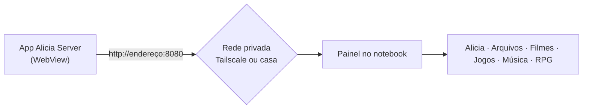

# O app Android (APK)

## Para que serve

O **APK do Alicia Server é a "janela" do servidor no celular e na TV box**. Ele não roda nada pesado, não guarda seus arquivos e não tem lógica própria: é um aplicativo **leve** que abre o painel do seu servidor em tela cheia, como se fosse um app de verdade, com ícone próprio na tela inicial (e na lista de apps da TV).

Por que ter um app, se o painel abre no navegador?

| No navegador | No app |
|---|---|
| Barra de endereço e abas ocupam a tela | **Tela cheia**, sem barras |
| Você precisa lembrar o endereço | O endereço fica **salvo** no app |
| Na TV box é difícil digitar e navegar | Aparece **na lista de apps da TV** e se navega pelo **controle remoto** |
| Microfone: o navegador pede em cada site | O app pede a **permissão do Android** uma vez |
| Celular faz a aba "dormir" | Fica como um app comum |

## O que o app faz

- **Abre o painel** (`http://<endereço>:8080`) numa `WebView` em tela cheia. Tudo que existe no painel funciona: Alicia, Arquivos, Filmes (Jellyfin dentro do painel), Jogos, Música, RPG, Servidor.
- **Tela de configuração do endereço:** na primeira abertura (e a qualquer momento pelo botão ⚙ ou pela tecla **MENU** do controle) você digita o endereço do servidor, com a porta. Assim você **muda o endereço sem gerar outro APK**. O endereço fica salvo em `SharedPreferences`.
- **Microfone:** para falar com a Alicia. O Android mostra o pedido de permissão só quando a página pede o microfone. **Sem microfone** (comum em TV box) a conversa por texto continua funcionando.
- **TV box:** declara a categoria *Leanback* (aparece no menu de apps da TV), funciona **sem tela de toque** e **sem microfone**, usa **tela deitada** e a navegação por **setas e OK** do controle remoto; o botão voltar volta uma página dentro do painel.
- **Mensagem amigável quando o servidor não responde**, dizendo o que conferir (servidor ligado, rede privada conectada, endereço certo).
- **Reprodução de mídia sem toque obrigatório**: a música e os jogos começam sem exigir um toque extra na WebView.

## O que o app **não** faz

- Não roda emulador, não converte vídeo, não toca música por conta própria: tudo isso é feito pelo painel/servidor e pelo navegador embutido.
- Não guarda senhas nem arquivos. O login é o do painel (cookie da própria `WebView`).
- Não funciona fora de casa **sem a rede privada**: no celular e na TV box é preciso instalar o **Tailscale** (loja oficial) e entrar na mesma conta do servidor; então o app usa o endereço da rede privada.
- Não é publicado na Play Store: é instalado direto (APK assinado por você).

## Escolha técnica

Foram comparadas as formas de transformar o painel em app:

| Opção | Decisão |
|---|---|
| **WebView nativo em Java** | ✅ **Escolhida**: a mais simples; só precisa de Gradle e Android SDK; cabe em um arquivo Java + um layout |
| PWA empacotada | Descartada: depende de recursos do navegador/loja e de HTTPS |
| Capacitor | Descartada: exige Node, plugins e mais camadas sem ganho aqui |

Detalhes: `minSdk 24` (Android 7.0+, cobre TV boxes antigas), `targetSdk 34`, `usesCleartextTraffic` ligado (o painel usa `http` dentro da rede privada), orientação `sensorLandscape`.

## Onde está e como compilar

- Projeto completo em [`alicia-apk/`](../alicia-apk): `MainActivity.java` (toda a lógica), `AndroidManifest.xml`, layout, ícone vetorial e arquivos do Gradle.
- **Compilar é pesado demais para o notebook servidor**, por isso é feito num PC. O guia completo e independente (instalar JDK 17, Gradle e Android SDK, gerar a chave de assinatura, compilar, assinar, instalar no celular e na TV box) está em [`alicia-apk/COMPILAR_NO_PC.md`](../alicia-apk/COMPILAR_NO_PC.md).
- Resumo: `gradle wrapper` → criar `alicia.jks` e `keystore.properties` → `gradlew assembleRelease` → `app/build/outputs/apk/release/app-release.apk`.
- **A chave de assinatura (`alicia.jks`) e `keystore.properties` nunca vão para o Git** (já estão no `.gitignore` do projeto).

## Usando no dia a dia

1. Instale o **Tailscale** e entre na conta do servidor (para usar fora de casa).
2. Instale o `AliciaServer.apk` (permita "instalar apps desconhecidos" só para o gerenciador de arquivos).
3. Abra o app e digite o endereço (`http://IP-DO-SERVIDOR:8080` em casa, ou o IP `100.x.y.z` da rede privada).
4. Entre com seu usuário ou toque em **"Entrar como visitante"**.
5. Para trocar o endereço depois: botão ⚙ no canto, ou **MENU** no controle da TV box.

## Estado

O projeto do app está **completo e documentado, mas ainda não foi compilado nem testado em aparelho** (não há JDK/SDK no notebook servidor, por decisão do projeto). Se aparecer erro de compilação, ele é pequeno e fácil de corrigir pelo log do Gradle. Veja [ESTADO.md](ESTADO.md).
