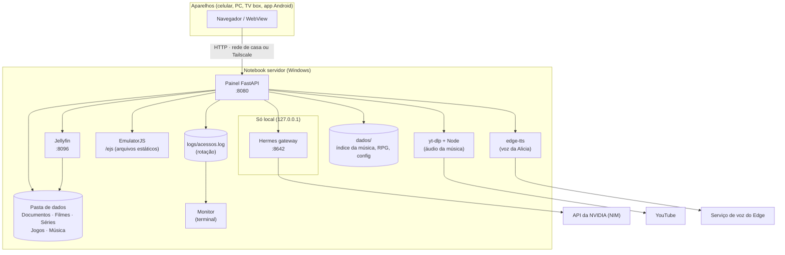
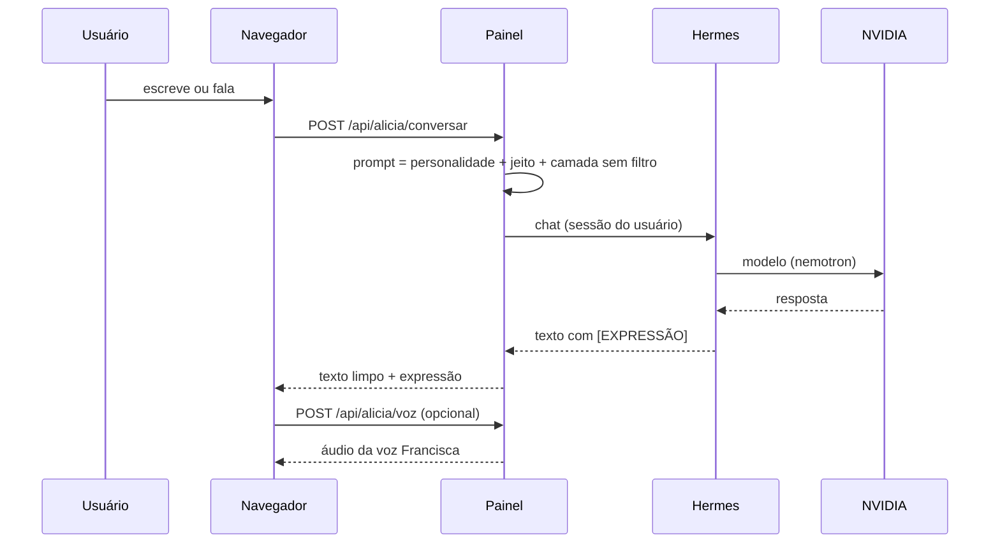
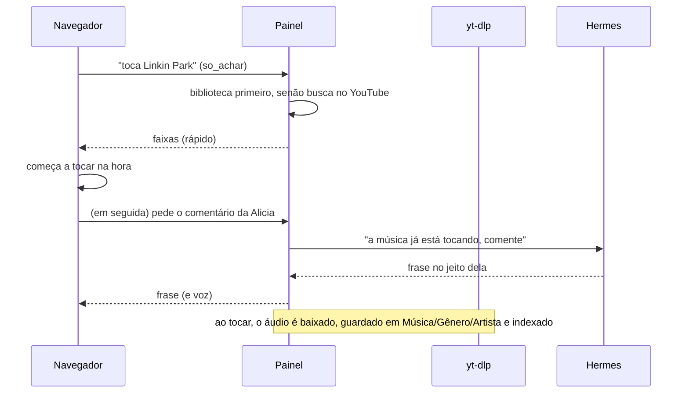

# Arquitetura

## Visão geral

## Componentes e portas

| Componente | Porta | Quem acessa | Como inicia |
|---|---|---|---|
| Painel (FastAPI/Uvicorn) | 8080 | rede de casa + Tailscale | tarefa `AliciaServer-Painel` |
| Hermes gateway (API OpenAI-compatível) | 8642 (só `127.0.0.1`) | só o painel | tarefa `AliciaServer-Hermes` |
| Jellyfin | 8096 | rede de casa + Tailscale | serviço do Windows |
| SSH (administração) | 22 | rede de casa + Tailscale | serviço do Windows |
| Pasta de rede (SMB) | 445 | só rede de casa | recurso do Windows |
| EmulatorJS | (servido pelo painel em `/ejs`) | navegador | arquivos estáticos |

Nenhuma porta é aberta no roteador.

## Pastas e dados

| Caminho | Conteúdo | No Git? |
|---|---|---|
| `painel/` | código do painel | sim |
| `alicia/` | prompts, personalidades, imagens, pôquer, app desktop legado | sim |
| `scripts/` | instalação, tarefas, monitor, backup, Hermes, demonstração | sim |
| `alicia-apk/` | projeto Android | sim |
| `painel/usuarios.json`, `painel/.segredo` | usuários (hashes) e chave dos cookies | **não** |
| `.env` | chaves (NVIDIA, Hermes, Jellyfin) | **não** |
| `dados/` | índice da música, mesas de RPG, configuração do painel, cache | **não** |
| `logs/` | registros e erros | **não** |
| `C:\AliciaServer\Alicia Server\` (padrão) | **Documentos, Filmes, Séries, Jogos, Música** | fora do repositório |
| `C:\AliciaServer\hermes\` | instalação do Hermes | fora do repositório |
| `C:\AliciaServer\emulatorjs\` | EmulatorJS (baixado do projeto oficial) | fora do repositório |

Os caminhos fora do repositório são configuráveis por variáveis de ambiente (`ALICIA_DADOS`, `ALICIA_EJS`, `ALICIA_BACKUP`, `HERMES_EXE`).

## Fluxos principais

### Conversa com a Alicia

### Pedido de música pela Alicia

### Jogo no navegador
1. O painel lista `Jogos/<console>/` e organiza arquivos pelo conteúdo.
2. Clicar abre `/jogar` numa **camada** (iframe) sobre o painel; o emulador (`/ejs`) carrega no navegador.
3. O jogo vem de `/api/jogos/arquivo`; o estado salvo vai e volta por `/api/jogos/save`.
4. O player de música fica fora da camada e não para.

## API do painel (resumo)

| Área | Rotas |
|---|---|
| Sessão | `POST /api/login` · `POST /api/logout` · `GET /api/eu` · `GET /api/publico` · `POST /api/visitante` |
| Administração | `GET/POST/DELETE /api/usuarios` · `POST /api/senha` · `POST /api/visitante/config` · `POST /api/hermes/reiniciar` |
| Estado | `GET /api/status` · `GET /api/hermes/info` · `POST /api/verificar` |
| Chave | `GET /api/nvidia` · `POST /api/nvidia/testar` · `POST /api/nvidia/salvar` |
| Arquivos | `GET /api/arquivos` · `POST /api/arquivos/enviar` · `GET /api/arquivos/baixar` · `DELETE /api/arquivos` · `POST /api/arquivos/pasta` |
| Alicia | `GET /api/alicia/opcoes` · `POST /api/alicia/conversar` · `POST /api/alicia/voz` · `POST /api/alicia/musica` · `GET /api/alicia/imagem/{nome}` |
| Música | `GET /api/musica/buscar` · `GET/POST /api/musica/biblioteca` · `GET /api/musica/servidor` · `GET /api/musica/audio/{id}` · `GET /api/musica/proxima` · `POST /api/musica/tocando` · `GET /api/musica/descobrir` · `GET /api/musica/mix` · `GET /api/musica/playlist` · `POST /api/musica/recomendar` · `POST /api/musica/guardar` · `GET /api/musica/guardando` |
| Jogos | `GET /api/jogos` · `GET /api/jogos/arquivo` · `GET /api/jogos/bios` · `GET/POST /api/jogos/save` · `GET /api/jogos/capa` · `GET /api/jogos/imagem` (capa automática) · `POST /api/jogos/favorito` · `GET /api/jogos/info` · `POST /api/jogos/inicio` · `POST /api/jogos/fim` · `POST /api/jogos/senha` · `POST /api/atividade` · `GET /jogar` |
| Filmes | `POST /api/filmes/enviar` |
| RPG | `GET /api/rpg/info` · `POST /api/rpg/sala` · `POST /api/rpg/entrar` · `GET /api/rpg/sala/{codigo}` · `POST …/falar` · `POST …/dado` · `POST …/combate` |
| Registros | `GET /api/logs` · `GET /api/logs/ao-vivo` (SSE) |

Todas exigem login, exceto `/api/login`, `/api/publico` e `/api/visitante`. O visitante só alcança Jogos, Música, Filmes (leitura), RPG e o estado básico.

## Decisões de projeto que moldaram a arquitetura

- **Nada de IA local**: o notebook é fraco; toda a IA usa a API da NVIDIA através do Hermes.
- **Trabalho visual no navegador**: o servidor entrega arquivos e dados; emulação de jogos e interface rodam no aparelho de quem usa.
- **Sem banco de dados pesado**: JSON pequeno gravado só quando algo muda, para poupar o HD mecânico.
- **Uma instância, poucos processos**: painel, gateway do Hermes e Jellyfin.

Mais em [DECISOES.md](DECISOES.md).
